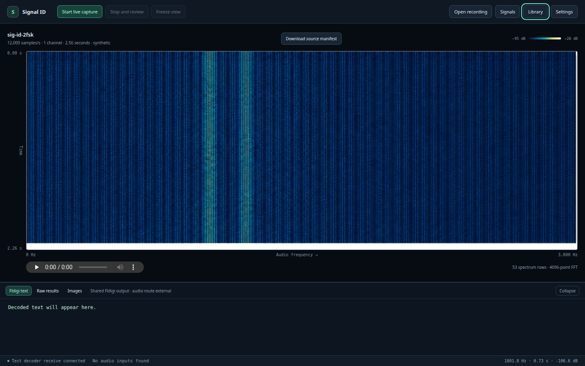

# Signal ID workbench

Signal ID is a local workbench for receiving, inspecting, labeling, and studying radio audio. It combines a live waterfall and recording review with signal annotations, protocol-independent symbol analysis, optional classifier and spectrogram detector workflows, and decoder integrations.

The mode catalog is useful for labeling; catalog entries do not imply automatic recognition or decoding support. Automated results are proposals for operator review. Synthetic and loopback evidence is kept distinct from real radio reception.



## Run with Docker Compose

On Linux, start the workbench with:

```sh
docker compose up --build -d
```

Open <http://127.0.0.1:8010>. If that port is in use, run `SIG_ID_PORT=8012 docker compose up --build -d` and open port 8012. Recordings and labels persist in a named volume. The default listener is local.

## Use the workbench

Open a recording or start live capture, then inspect the waterfall. Select a candidate or drag across a region to open its inspector. Classify and Annotate workflows keep identity, decode, raw-symbol, and box review actions together. Saving a label is explicit; selecting a candidate does not change decoder settings or save an annotation.

For local development, install Python 3.11 or newer and run:

```sh
python3 -m venv .venv
. .venv/bin/activate
python -m pip install -e '.[dev,audio]'
sig-id-serve
```

Then open <http://127.0.0.1:8010>. Local audio capture also requires the platform PortAudio runtime and an input selected in Settings.

## Project guides

- [Operations](OPERATIONS.md): updates, model setup, backup and restore.
- [OnAir event adapter](docs/ONAIR_EVENT_BRIDGE.md): optional live fallback for modes not implemented natively; no saved-WAV replay, setup and limits.
- [Independent decoder library](docs/LIBSIGDECODE.md): in-project CW, modular decoder contract and ham-mode roadmap; external backends are optional.
- [Multi-mode Signal Lab](docs/SIGNAL_LAB.md): receive-only virtual loopback for CW/RTTY/BPSK31/AX.25, sparse one- or two-station bursts across widely spaced passband lanes, optional fully crowded stress mode and pinned decoded truth (never RF/PTT).
- [Automatic native live decoding](docs/NATIVE_LIVE_DECODING.md): CPU-budgeted worker runs native modem attempts against persistent live detector tracks and surfaces unverified coherent output plus latency/CPU metrics.
- [Waterfall Time Lens](docs/WATERFALL_TIME_LENS.md): 60-second log-like live display with newest seconds expanded, exact sample-to-screen selection and no changes to decoder audio.
- [Decoder agent start page](docs/DECODER_AGENT_PLAYBOOK.md): implementation API, source/evidence links and machine-readable 36-mode work queue for parallel agents.
- [Crowded-signal benchmark](docs/CROWDED_AUDIO_BENCHMARK.md): high-resolution split previews, real 40m replay, and accuracy metrics with reviewed references.
- [Browser verification](tests/GUI.md): isolated UI workflow checks and their limits.
- [Distributed collection](DISTRIBUTED_COLLECTION_PLAN.md): contribution and peer review design.
- [Engineering and dataset reference](docs/README-REFERENCE.md): detailed features, research notes, and reproducible workflows.
- [Implementation plan](IMPLEMENTATION_PLAN.md) and [current checkpoint](NEXT.md).

The workbench is under active development. Decoder and model availability depends on local configuration; radio hardware routing and field performance require separate validation.
