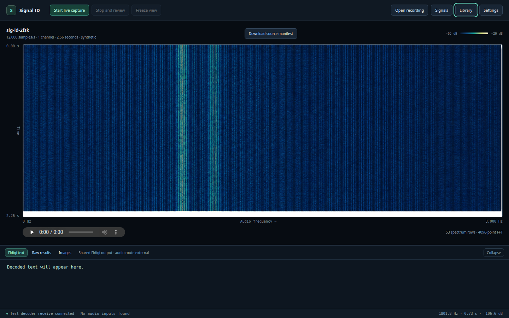

# Signal ID workbench

A digital radio receive, identification and dataset workbench is being built in
staged releases. The full plan is in [IMPLEMENTATION_PLAN.md](IMPLEMENTATION_PLAN.md);
the current engineering checkpoint is [NEXT.md](NEXT.md).

## Current state

The receive workspace centers on the waterfall. Click a signal label or drag a region
to open its inspector, then choose Label, Decode or Raw symbols. Selecting a signal
does not change the decoder mode or save a label. Results appear in the bottom dock.
Open recordings and import synthetic fixtures through Library; audio device/rate and
automatic-trial settings are in Settings. Freeze view pauses display following while
live recording continues; Stop and review finishes and saves the recording.
The live waterfall shows thirty seconds with a fixed startup scale and receives new
spectrum rows in binary batches independently of candidate analysis. Missing display
updates appear as gaps. See [browser verification](tests/GUI.md) for repeatable UI checks.
Saved annotation markers open their label and revision history in the inspector.
Save revision preserves earlier labels and rejects stale concurrent edits. Hover or
focus a signal tag for frequency, SNR, tone-spacing and drift evidence when available.
Graceful server shutdown finalizes live audio. A writer failure preserves completed
blocks as a partial capture; if metadata cannot be saved, the error reports the retained
WAV path so it can be recovered through Open recording.



Current code includes WAV upload/playback with a fixed 0–3 kHz browser waterfall
(4096-point FFT at the default 48 kHz capture rate, about 11.7 Hz per bin), manual
time/frequency selection and label export; blockwise PCM replay; deterministic
2-FSK and generic MFSK fixture generators; verified synthetic import into the SQLite
capture/label dataset; and a receive-only Fldigi XML-RPC probe. Local device capture
and the Fldigi path from audio input to recovered text are represented in the
workbench: when a running Fldigi XML-RPC service is available, users can select a
catalog mode and view its receive-text output. RF-free loopback tests decode BPSK31,
BPSK63, RTTY, THOR8, THOR16, MFSK16, MFSK32, MT63-500S and MT63-1KS payloads through
temporary virtual audio into the workbench API and isolated saved-region replay.
Routing actual radio input
to Fldigi remains an external setup and is not yet validated. The workbench also
offers bounded Fldigi mode trials for live candidates. The “Auto-try accepted model IDs”
checkbox opts into starting a sweep only after a track persists and the loaded model
accepts a method; abstentions never start trials. Automatic and manual live-track
sweeps replay the candidate's exact buffered samples through isolated Fldigi instances,
trying up to three tested modes. Recovered text stays tentative until reviewed. In the
inspector, a selected live track can also be replayed in one chosen mode from its exact
sample window in the bounded live buffer; stale windows are rejected and output is
attached to the live session, then linked to the saved capture when recording stops.
Saved recordings let you select a region and replay it through the same
temporary PulseAudio/PipeWire loopback. The selected mode's output is stored with the exact
capture window. “Tag region as selected mode” saves a human-reviewed label as a
separate explicit action. This native-host feature requires Fldigi, its configured
profile, `xvfb-run`, `pactl`, and `paplay`; it does not change the running receiver or
transmit. It is not available in the default Compose container, which has no host audio
server or Fldigi profile mounted. Saved recordings
have a manual, protocol-independent 2-FSK demodulator that exposes uncoded bits,
symbol timing and soft tone metrics; symbol rate and tone mapping are operator-supplied,
with an optional 32-phase timing search. A corresponding M-FSK analyzer returns hard tone indices,
soft margins and natural-binary bits only for power-of-two tone counts, with the same
optional 32-phase timing search. It can also rank a bounded logarithmic symbol-rate
grid while searching timing phase at each candidate rate. The OOK analyzer estimates
two noncoherent carrier-amplitude levels, returns raw bits and soft metrics, and offers
timing search; it leaves bits undecided when there is no measurable two-level contrast.
BPSK analysis
returns both global polarity hypotheses, while QPSK analysis returns four possible
90-degree rotation hypotheses because an unknown capture has no inherent absolute
phase reference. These are protocol-independent symbol/bit observations, not complete
protocol decoders. Each demodulator can export a JSON artifact containing the capture
hash, sample bounds, settings, raw decisions, ambiguity/soft metrics and protocol-unknown
status so a manual analysis can be reproduced or used as training evidence. The raw-bit
view aligns recovered bytes with printable ASCII. Operators can select byte ranges,
add colored interpretation tags and include them in the JSON export. Exact `01111110`
patterns are marked as possible HDLC-like flags; this is only a framing clue, not a
mode or protocol identification.

## Run with Docker Compose on Linux

```sh
docker compose up --build -d
```

Open <http://127.0.0.1:8010>. If the native app already uses that port, prefix the
command with `SIG_ID_PORT=8012` and open port 8012 instead. Recordings and labels
persist in a named volume. The default listener is local; host networking reaches
the separately running host Fldigi XML-RPC service. Direct host audio-device routing
into the container is not configured automatically; use the native audio setup for it.
See [OPERATIONS.md](OPERATIONS.md) for updates, models, tested backup/restore and
repeatable container checks.

## Development

Requires Python 3.11 or newer and pytest. From the repository root:

```sh
python3 -m venv .venv
. .venv/bin/activate
python -m pip install -e '.[dev,audio]'
pytest
sig-id-serve
```

Local audio capture also needs the platform PortAudio runtime (`libportaudio2` on
Debian/Ubuntu). Select the radio input in Settings before starting live capture.

The opt-in, RF-free Fldigi audio loopback tests exercise BPSK31, BPSK63, RTTY, THOR8,
THOR16, MFSK16, MFSK32, MT63-500S and MT63-1KS using isolated profiles and a temporary
PulseAudio/PipeWire null sink.
They require a configured `~/.fldigi`, `xvfb-run`, and `pactl`:

```sh
SIGID_TEST_FLDIGI_AUDIO=1 pytest tests/test_fldigi_audio_integration.py
```

The saved-region replay worker has a separate end-to-end check. It captures a known
transmission from a temporary null sink, then decodes that WAV through the same
isolated replay path used by the inspector. BPSK31, BPSK63, RTTY, THOR8, THOR16,
MFSK16, MFSK32, MT63-500S and MT63-1KS are covered:

```sh
SIGID_TEST_FLDIGI_REGION_REPLAY=1 pytest -s tests/test_fldigi_audio_integration.py -k known_fldigi_transmission
```

The reference per-mode capability registry distinguishes catalog presence, successful
selection and verified decoding. Its generated evidence for Fldigi 4.2.13 is in
[`reports/fldigi-4.2.13-capabilities.json`](reports/fldigi-4.2.13-capabilities.json).

To audit selection of every mode in an isolated Fldigi profile (without changing
the operator's running Fldigi mode), run:

```sh
SIGID_TEST_FLDIGI_CATALOG=1 pytest -s tests/test_fldigi_audio_integration.py -k every_installed_catalog_entry
```

The reference Fldigi 4.2.13 selection results are in
[`reports/fldigi-4.2.13-catalog-selection.json`](reports/fldigi-4.2.13-catalog-selection.json).
Of the 168 actual modem entries, 165 select through XML-RPC. The three OFDM entries
are documented Fldigi modes, but this installed backend stays on BPSK31 when asked to
select them; see the [Fldigi OFDM manual](https://www.w1hkj.org/files/fldigi/fldigi_help.pdf).
`RSID_EOT` is a catalog marker, not a receive mode, and is omitted from the workbench's
selectable list. The audit tests selection only; it does not establish audio routing or
decode support.

Then open <http://127.0.0.1:8010>, choose a PCM WAV, and mark a signal region on
the waterfall. The local service stores audio under `~/.local/share/sig-id` by
default. Set `SIG_ID_DATA_DIR` before starting it to use another data directory.

The installed Fldigi process can be inspected with:

```sh
sig-id-probe-fldigi --url http://127.0.0.1:7362/RPC2
```

Enable Fldigi's XML-RPC server on loopback before launching the workbench. Set
`SIG_ID_FLDIGI_URL` if it listens on a different local URL. The decoder panel lists
the installed catalog, selects a receive mode, and polls incremental receive text.
Completed Fldigi WEFAX images can also be imported into the workbench's managed
receive-products store and viewed in its received-image gallery.
Route the radio passband audio to Fldigi's input using the audio system configuration;
the application does not silently create an audio route or claim decode validation.
When starting Fldigi from a terminal, its XML-RPC method allow-list can be limited to
the calls the application uses:

```sh
fldigi --xmlrpc-server-address 127.0.0.1 \
  --xmlrpc-allow='^(fldigi\.(name|version)|modem\.(get_names|get_name|set_by_name)|text\.(get_rx|get_rx_length)|wefax\.get_received_file)$'
```

Restrict its XML-RPC method allow-list to the receive and inspection methods needed
by the application. Do not expose Fldigi's control endpoint outside loopback.

Create a clean binary-FSK fixture with a sidecar manifest containing the exact
reference bits and modulation parameters:

```sh
sig-id-generate-2fsk data/fixtures/fsk.wav 001101101001
```

Generate a protocol-independent 4-FSK/MFSK fixture with exact source symbols,
binary tone mapping, modulation-method labels, and no invented protocol label:

```sh
sig-id-generate-mfsk data/fixtures/mfsk4.wav 0,1,3,2 --symbol-rate 100
```

Generate an uncoded BPSK fixture with its exact reference bits and carrier parameters:

```sh
sig-id-generate-bpsk data/fixtures/bpsk.wav 001101101001 --carrier-hz 1500
```

Generate an uncoded Gray-mapped QPSK fixture with its exact reference bits and carrier
parameters:

```sh
sig-id-generate-qpsk data/fixtures/qpsk.wav 001101101001 --carrier-hz 1500
```

Generate a synthetic OOK/ASK fixture. OOK is deliberately outside the current model's
FSK/PSK taxonomy and can be used as a held-out unknown-family example:

```sh
sig-id-generate-ook data/fixtures/ook.wav 001101101001 --carrier-hz 1500
```

Generate a generic four-level ASK waveform with exact level symbols and natural-binary
bits, while leaving its protocol unknown:

```sh
sig-id-generate-ask data/fixtures/ask4.wav 0,1,3,2 --level-count 4 --symbol-rate 100
sig-id-generate-ppm data/fixtures/ppm.wav 01011010 --symbol-rate 100 --pulse-fraction 0.2
```

Register the waveform and validated sidecar in the local dataset from the command
line, or choose both files in the workbench's **Synthetic Dataset** panel:

```sh
sig-id-import-synthetic data/fixtures/mfsk4.wav
```

The importer verifies that the WAV exactly matches a deterministic 2-FSK, M-FSK,
BPSK, QPSK, OOK, M-ASK or PPM generator manifest, then stores a full-capture modulation label and the source
manifest. It does not invent a named protocol.

Combine already imported, accepted synthetic captures into a deterministic scene.
Put their capture IDs in a JSON recipe; offsets and lengths are in samples at the
source sample rate, and overlapping components retain separate labels on import.
Optional `frequency_offset_hz` and `drift_hz_per_second` values shift each signal
before mixing, with drift measured across that component's duration. `lowpass_hz`
adds a deterministic smooth low-pass rolloff to model receiver/audio bandwidth, and
`clock_error_ppm` changes the rendered symbol/audio clock by resampling the component.
The manifest records the original source length and the rendered region length:

```json
{
  "components": [
    {"capture_id": "CAPTURE_ID_A", "sample_count": 48000, "scene_start_sample": 0, "gain": 0.7, "frequency_offset_hz": 125, "drift_hz_per_second": 2, "clock_error_ppm": 2500},
    {"capture_id": "CAPTURE_ID_B", "sample_count": 48000, "scene_start_sample": 24000, "gain": 0.4, "lowpass_hz": 2700}
  ]
}
```

```sh
sig-id-mix-scene --data-dir ~/.local/share/sig-id scene-recipe.json data/scenes/mix.wav
sig-id-import-scene --data-dir ~/.local/share/sig-id data/scenes/mix.wav data/scenes/mix.wav.json
```

Measure provisional spectral candidate detection on all imported mixed scenes and
noise-only examples in the dataset. The method classifier learns a separate noise
class from those split-safe corpus examples; this does not identify unseen modulated
modes. The report includes per-capture matches, component
recall, candidate precision, and false candidates per hour:

```sh
sig-id-evaluate-detector --data-dir ~/.local/share/sig-id --output data/reports/detector-scenes.json
```

This benchmark measures temporal candidate coverage for deterministic synthetic
scenes; it does not establish real-radio performance or classification accuracy.

Scene imports re-render against the original accepted synthetic captures before
storing, so edited samples or recipe fields cannot pass as synthetic ground truth.
The split command keeps every component lineage used by an indexed scene in one
partition and reports scenes whose sources are absent from the corpus. Scene regions
are not classifier training examples. The model evaluation report separately scores
scene constituent regions whose source lineages were assigned to the held-out test
partition, with overlapping signals present in the audio crop.

Create a deterministic noisy child from an imported clean source. Import the clean
source first; the child manifest records its hashes and recipe, and the importer checks
the parent lineage and regenerates the samples before accepting inherited labels:

```sh
sig-id-augment-awgn data/fixtures/bpsk.wav data/fixtures/bpsk-10db.wav --snr-db 10 --seed 42
sig-id-import-synthetic data/fixtures/bpsk-10db.wav
```

Build a small resumable corpus across six modulation methods. Each clean source and
its AWGN descendants share a `lineage_group` in the index so they can be kept in one
train/validation/test split:

```sh
sig-id-build-corpus --output-dir data/corpus --examples-per-mode 12 --snr-db 0 10 20 --seed 42
sig-id-split-corpus --corpus data/corpus/corpus.json --output data/corpus/splits.json --seed 42
sig-id-build-ood-corpus --output-dir data/ood/unknown --examples 30 --seed 42
sig-id-train-method-model --split data/corpus/splits.json --ood-corpus data/ood/unknown/ood-corpus.json \
  --output-model data/models/method.npz
```

This creates 288 labeled modulation captures (six methods × twelve source examples ×
one clean plus three SNR variants) and twelve independent noise-only negative captures.
The negatives retain null modulation/protocol labels and are used for rejection
calibration/evaluation, not as a seventh modulation class. The index and generated
audio stay in `data/corpus`; imported
captures and labels are stored under `SIG_ID_DATA_DIR` or the normal application data
directory. Re-running the same command resumes without duplicating captures; changing
the recipe requires a new output directory.
The split command validates each dataset capture and label, requires at least three
independent source groups per method and for noise negatives, and assigns every clean
waveform and all derived impairments to one train, validation or test split.
The training command fits a small NumPy logistic-regression baseline, calibrates
separate method and family rejection thresholds on known validation groups and, when
`--ood-corpus` is supplied, includes its unknown-family validation sources as negatives only for
threshold calibration. It evaluates once on the held-out known-mode groups and separate
unknown-family test sources, then writes weight, metadata and evaluation files. The corpus
assigns independent source indices 3:2 to threshold-validation:test; none enters model
fitting. To load
the exported proposal model in the workbench, set `SIG_ID_MODEL_PATH` to the `.npz`
file before starting `sig-id-serve`. Proposals never save labels automatically.
The model uses zero-false-accept validation constraints for noise and supplied unknown families
negatives, and reports held-out rates separately. If the constraints and known-mode
precision target cannot both be met, it abstains on every example; small corpora can
therefore yield zero useful coverage. The current reproducible mixed ASK experiment,
including corpus, split, model and waveform hashes, is saved in
[`reports/ask-ood-benchmark-2026-10-21.json`](reports/ask-ood-benchmark-2026-10-21.json).
Its method threshold accepted only 9/26 known test examples (100% accuracy among
accepted), while its family threshold rejected every family proposal. The held-out ASK
test had 0/12 method and family false accepts. This is one synthetic split only; other
unknown modes and radio performance remain unvalidated.

To reproduce that report in a fresh workspace, run the following commands (the
generated corpus, database and model are written under `/tmp`):

```sh
export SIG_ID_DATA_DIR=/tmp/sig-id-ask-benchmark-data
sig-id-build-corpus --output-dir /tmp/sig-id-ask-benchmark/known --data-dir "$SIG_ID_DATA_DIR" \
  --examples-per-mode 12 --snr-db 10 --seed 20261021
sig-id-split-corpus --corpus /tmp/sig-id-ask-benchmark/known/corpus.json \
  --data-dir "$SIG_ID_DATA_DIR" --output /tmp/sig-id-ask-benchmark/known/splits.json --seed 27
sig-id-build-ood-corpus --output-dir /tmp/sig-id-ask-benchmark/ask --examples 30 --seed 1717 --generator-version 0.2.0
sig-id-train-method-model --split /tmp/sig-id-ask-benchmark/known/splits.json \
  --data-dir "$SIG_ID_DATA_DIR" --ood-corpus /tmp/sig-id-ask-benchmark/ask/ood-corpus.json \
  --output-model /tmp/sig-id-ask-benchmark/model/method.npz --epochs 1200 \
  --feature-version passband-log-spectrum-v1
```

The initial diverse benchmark above uses spectral features only and reproduces the
zero-coverage result with feature version `passband-log-spectrum-v1`. The current model
adds six temporal envelope features and a novelty gate based on distance to trained
modulation centroids. The default OOD generator adds binary PPM alongside OOK and 4-ASK.
To reproduce the current result, use the new benchmark output paths and train against
that index:

```sh
sig-id-build-ood-corpus --output-dir /tmp/sig-id-ask-benchmark/diverse --examples 30 --seed 1717
sig-id-train-method-model --split /tmp/sig-id-ask-benchmark/known/splits.json \
  --data-dir "$SIG_ID_DATA_DIR" --ood-corpus /tmp/sig-id-ask-benchmark/diverse/ood-corpus.json \
  --output-model /tmp/sig-id-ask-benchmark/model/ask-ppm.npz --epochs 1200 \
  --feature-version passband-log-spectrum-envelope-v2
```

The measured result is preserved in
[`reports/ask-ppm-novelty-benchmark-2026-10-21.json`](reports/ask-ppm-novelty-benchmark-2026-10-21.json).
On this split it retains 84.6% known test coverage at 86.4% accepted accuracy, while
rejecting 12/12 held-out OOK, 4-ASK and PPM sources. These are synthetic recipe results;
independent recordings and radio captures remain untested.

To measure split-seed sensitivity, use the lineage-safe multi-seed runner. It creates
one model per distinct source-group assignment and excludes duplicate assignments from
aggregate statistics:

```sh
sig-id-build-corpus --output-dir /tmp/sig-id-multiseed/known --data-dir "$SIG_ID_DATA_DIR" \
  --examples-per-mode 12 --snr-db 10 --seed 20261021
sig-id-build-ood-corpus --output-dir /tmp/sig-id-multiseed/unknown --examples 30 --seed 1717
sig-id-evaluate-split-seeds --corpus /tmp/sig-id-multiseed/known/corpus.json \
  --data-dir "$SIG_ID_DATA_DIR" --output-dir /tmp/sig-id-multiseed/runs \
  --seeds 11 23 37 51 79 --epochs 1200 \
  --ood-corpus /tmp/sig-id-multiseed/unknown/ood-corpus.json
```

Split assignment version 2 makes seed variation affect lineage ordering; the default
split command retains version 1 for exact historical reproduction. The five-seed result
is archived in [`reports/multiseed-ask-ppm-2026-10-21.json`](reports/multiseed-ask-ppm-2026-10-21.json).
Across five distinct splits, mean known test coverage was 64.6%, mean accepted accuracy
79.8%, and method/family false accepts were 0/12 on every split. Accepted accuracy ranged
from 58.8% to 93.8%, showing that the earlier single-split estimate was optimistic. This
remains synthetic-only evidence.

The runner also reports held-out metrics by clean, noise and AWGN SNR. A 444-capture
corpus with clean sources and 0, 3, 6, 10 and 20 dB AWGN siblings produced five distinct
test splits. Mean coverage ranged from 78.3% to 85.0% across noisy conditions, but clean-
source coverage was only 13.3% (76.7% accuracy among the few accepted clean examples).
That is a weakness in the current rejection behavior; all per-SNR results and provenance
hashes are in [`reports/channel-snr-multiseed-2026-10-21.json`](reports/channel-snr-multiseed-2026-10-21.json).
This sweep tests AWGN only, not fading, multipath or impulsive interference.

To reproduce the SNR sweep, point both corpus builders at the same data directory so
the split tool can verify the indexed captures:

```sh
export SIG_ID_DATA_DIR=/tmp/sig-id-channel-benchmark/data
sig-id-build-corpus --output-dir /tmp/sig-id-channel-benchmark/known --data-dir "$SIG_ID_DATA_DIR" \
  --examples-per-mode 12 --snr-db 0 3 6 10 20 --seed 20261021
sig-id-build-ood-corpus --output-dir /tmp/sig-id-channel-benchmark/unknown --examples 30 --seed 1717
sig-id-evaluate-split-seeds --corpus /tmp/sig-id-channel-benchmark/known/corpus.json \
  --data-dir "$SIG_ID_DATA_DIR" --output-dir /tmp/sig-id-channel-benchmark/runs \
  --seeds 11 23 37 51 79 --epochs 1200 \
  --ood-corpus /tmp/sig-id-channel-benchmark/unknown/ood-corpus.json
```

Build independent synthetic OOK, 4-ASK and pulse-position sources with varied payload,
baud rate, carrier, amplitude, phase and pulse width. This diverse corpus is separate
from the six-class training index and is passed separately to the trainer above. Version
0.2.0 remains available for exact regeneration of the historical ASK-only experiment.
To build the diverse benchmark and re-run post-hoc scoring on an already trained model:

```sh
sig-id-build-ood-corpus --output-dir data/ood/unknown --examples 30 --seed 42
sig-id-evaluate-ood --model data/models/method.npz data/ood/unknown/waveforms/*.wav \
  --output data/ood/unknown/evaluation.json
```

The JSON report records per-waveform hashes and method/family false-accept rates. The
standalone evaluator does not alter a model threshold; use `--ood-corpus` during
training when unknown-family rejection should affect calibration. This measures only the supplied
synthetic ASK and PPM conditions; it does not establish general unknown-mode or field
performance.

Replay it blockwise from Python with `sigid.wav.WavSource`; blocks carry exact sample
offsets and normalized mono samples. This is a modulation fixture, not a named
protocol waveform.

## Data sources

Generated waveforms, saved captures, and curated external reference examples will
remain distinguishable in provenance and label confidence. See the dataset and
Signal Identification Wiki guidance in [DESIGN.md](DESIGN.md).

Create a bounded metadata catalog from [Signal Identification Wiki](https://www.sigidwiki.com/wiki/Signal_Identification_Guide) pages without
downloading their audio or images:

```sh
sig-id-import-sigidwiki --output data/references/sigidwiki.json --limit-per-category 25
```

The catalog preserves the page URL, revision, source-reported fields and media links.
Wiki labels remain unreviewed references, not accepted training labels; media stays
link-only until reuse rights are reviewed per asset. Use `--categories Signal` to
catalog only identified entries, or add a different category explicitly.
